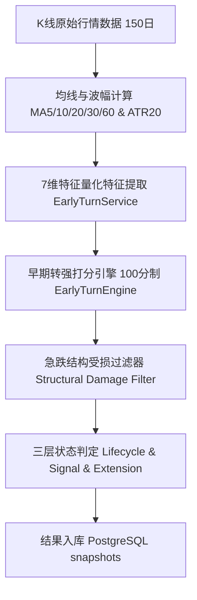
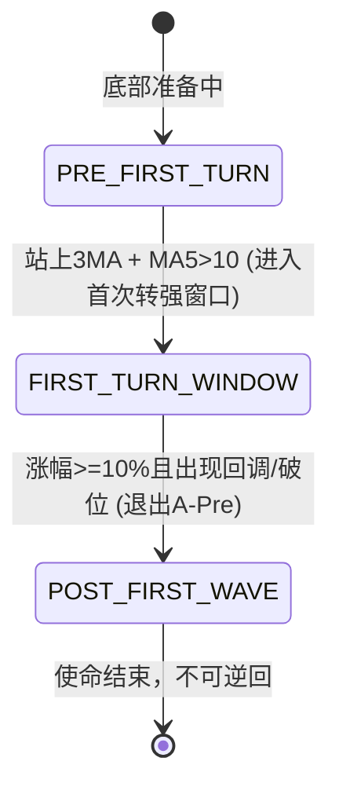

# A-Pre V2 早期转强技术选股策略实现说明文档 (V2.0)

本说明文档详细阐述了 A-Pre V2 (早期转强实验选股策略) 在系统后台的量化算法、数学公式、三层状态机架构及核心数据过滤机制的技术实现，方便后续开发交接与策略复盘。

---

## 一、 系统全数据链路概述

选股引擎基于 Point-in-Time 时间点无未来函数进行全量计算，全链路流转如下：



---

## 二、 七维度核心评分算子与权重

总分为 **100分制**，累加各评分维度得分：

### 1. 均线状态转换 (MA Regime Transition) —— 最大 25 分
主要评估均线的离散压缩（Compression）和结扎交叉网络（MA Knot）状态。
* **均线高度压缩 (Compression)**：
  * 计算 MA5、MA10、MA20、MA30 四根均线的最大离散度并除以波动率 ATR20（以 ATR 波动倍数衡量紧凑度）：
    $$\text{MA Spread ATR} = \frac{\min(\text{MA}_{30} - \text{MA}_5, \text{MA}_{30} - \text{MA}_{10})}{\text{ATR}_{20}}$$
  * 评分规则：
    * $\text{MA Spread ATR} \le 0.51 \text{ ATR}$：**+15 分**
    * $\text{MA Spread ATR} \le 0.80 \text{ ATR}$：**+10 分**
    * $\text{MA Spread ATR} \le 1.20 \text{ ATR}$：**+5 分**
* **压缩改善度**：当前 3-MA spread 相比 5 个交易日前 spread 的压缩比率：
  * 压缩比率 $< 0.80$：**+5 分**
  * 压缩比率 $< 0.95$：**+3 分**
* **均线结结扎 (MA Knot)**：统计最近 10 个交易日内，MA5、MA10、MA20、MA30 之间发生交叉的对数（Cross Pairs）：
  * 发生交叉对数 $\ge 3$ 对：**+5 分**
  * 发生交叉对数 $\ge 2$ 对：**+3 分**
* **震荡扣分 (Chop Penalty)**：统计 10 日内收盘价穿透任意均线的次数（Cross Events），过滤频繁震荡没有方向的噪音股：
  * 穿透次数 $\ge 8$ 次：**扣 6 分**
  * 穿透次数 $\ge 4$ 次：**扣 3 分**
  * $\text{Transition Score} = \max(0, \text{Transition Score} - \text{Chop Penalty})$

### 2. 价格夺回成本区 (Price Retake) —— 最大 15 分
评估股价对中短期均线的控制力。
* **夺回数量 (Retake Count)**：当前收盘价站上 MA5、MA10、MA20、MA30 四根均线的个数：
  * 站上所有 4 根均线 (Retake Count = 4)：**+15 分**
  * 站上 3 根均线 (Retake Count = 3)：**+10 分**
  * 站上 2 根均线 (Retake Count = 2)：**+5 分**
* **时效延迟扣分**：若股价已连续站上 3 根均线的时间（`days_retake_3ma`）超过 3 天：**扣 5 分**。

### 3. 突破新鲜度 (Freshness) —— 最大 10 分
为了防止股票进入高位横盘后仍被算作新转强，系统引入了新鲜度保护。
* **前置条件**：**必须满足 `retake_count >= 3` 且 `days_retake_3ma >= 1`，否则新鲜度强制计 0 分**。
* **时效计分**：
  * 连续站上 3MA 的天数 $\le 2$ 天：**+10 分**（新鲜度极佳）
  * 连续站上 3MA 的天数 $\le 5$ 天：**+7 分**
  * 连续站上 3MA 的天数 $\le 10$ 天：**+4 分**
  * 否则：**+1 分**

### 4. 方向性转向 (Directional Turn) —— 最大 15 分
计算四根均线的短中长期排列改善状态。
* 均线多头相对位次排列得分 `order_score`（基于 MA5>10, MA5>20, MA10>20, MA20>30 判定）：
  * `order_score` $\ge 3.0$：**+10 分**
  * `order_score` $\ge 2.0$：**+5 分**
* 排列改善度：相较于 5 个交易日前排列分有所提高 (`order_improvement > 0`)：**+5 分**。

### 5. 背景与底分 (Background Base) —— 最大 15 分
根据其技术转强背景进行基准评分：
* **首次转强 (FIRST_TURN)**：**+15 分**
* **二次转强 (SECONDARY_TURN)**：**+12 分**
* **横盘整理再启动 (CONSOLIDATION_RESTART)**：**+10 分**

### 6. 成交量能确认 (Volume Confirmation) —— 最大 10 分
计算当天成交额相较于 60 日成交额中位数的比率（`volume_ratio`）：
* `volume_ratio` $\ge 1.5$：**+10 分**（放量确认）
* `volume_ratio` $\ge 1.1$：**+6 分**
* `volume_ratio` $\ge 0.8$：**+4 分**

### 7. 空间与过度延伸 (Space & Extension) —— 最大 10 分
* 股价偏离 20MA 离散度：$\text{Extension ATR} = \frac{\text{close} - \text{MA}_{20}}{\text{ATR}_{20}}$
  * $\text{Extension ATR} \le 1.0$ ATR：**+5 分**
  * $\text{Extension ATR} \le 1.5$ ATR：**+3 分**
  * $\text{Extension ATR} \le 2.0$ ATR：**+1 分**
* 60 日阻力空间及上盖峰值：距 60 日最高价空间 $\ge 8\%$：**+5 分**；$\ge 4\%$：**+3 分**；若无密集上盖峰值阻力（`overhead_resistance_flag == False`）：**+2 分**。

---

## 三、 三层状态机判定逻辑

为了实现专业交易视角的精准划分，系统采用了三层状态判定逻辑，独立理清了**“转强生命周期”**、**“技术成熟度”**与**“买点追高风险”**的关系。



### 第一层：生命周期阶段 (`turn_episode_state`)
本层核心解决如“千红制药”、“紫光股份”等已走完第一波行情并在高位完成震荡回调的股票，能够被强制退出 A-Pre 早期转强池。
* **`PRE_FIRST_TURN` (底部准备中)**：尚未启动。
* **`FIRST_TURN_WINDOW` (首次转强窗口)**：
  * **触发进入条件**：股价收盘满足站上至少 3 根均线 (`retake_count >= 3`)，且排列分 `order_score >= 2.0` 且 `MA5 > MA10`。
  - **记录首次触发数据**：记录首次触发日期 `first_trigger_date`、首次触发价格 `first_trigger_close`。
* **`POST_FIRST_WAVE` (第一波已完成 - 退出 A-Pre 机制)**：
  - **触发退出条件**：
    - 自触发价以来的最大涨幅满足：收盘价涨幅 $\ge 10\%$ 或 最高价相对于触发收盘价涨幅超过 $3.5 \text{ ATR}_{20}$。
    - **并且** 出现显著回调：自触发以来最高价回撤幅度 $\ge 6\%$，或者收盘价跌破 30 日均线 (`close < MA30`)。
    - 一旦进入 `POST_FIRST_WAVE` 状态，此股该轮行情中将**永久退出 A-Pre**，不可再逆向回到 `FIRST_TURN_WINDOW`。

### 第二层：技术信号状态 (`signal_status` 或 `state`)
反映当前技术状态的强度和最终选股评分的高低。
1. **`POST_FIRST_WAVE`**：当生命周期进入该状态，无论技术指标分数多高，信号直接锁定为 `POST_FIRST_WAVE`，不可入选。
2. **`EARLY_TURN`**（转强信号）：必须满足 `FIRST_TURN_WINDOW` 且 `retake_count >= 3`，且 `total_score >= 75.0` 且未受损。
3. **`PRE_READY`**（重点观察）：满足 `total_score >= 65.0`。
4. **`WATCH`**（初步观察）：满足 `total_score >= 50.0`。
5. **`NO_SIGNAL`**（无信号）：不满足上述条件。

### 第三层：买点偏离状态 (`entry_extension_state`)
独立回答 **“当前位置建仓，股价是否偏离安全位置（是否在追高）”**。
* **`NOT_APPLICABLE`**：当为 `POST_FIRST_WAVE` 时为不可用。
* **`VERY_EXTENDED` (位置追高 - 警告状态)**：满足以下任意一条即触发位置风控：
  1. 股价相比首次转强触发价涨幅超过 8% (`return_since_first_trigger > 0.08`)。
  2. 股价偏离 20MA 离散度超过 2.0 ATR (`extension_atr > 2.0`)。
  3. 股价偏离 20MA 百分比超过 18% (`(close - ma20)/ma20 > 0.18`)。
* **`EXTENDED` (买点略延伸 - 略微追高)**：
  1. 相比首次触发价涨幅超过 4% (`return_since_first_trigger > 0.04`)。
  2. 偏离 20MA 离散度超过 1.5 ATR (`extension_atr > 1.5`)。
* **`NORMAL` (买点正常 - 界面上默认隐藏，不增加额外干扰信息)**。

---

## 四、 核心过滤机制

### 1. 急跌结构受损过滤器 (Structural Damage Filter)
该过滤器旨在回避在大熊市阴跌或强阻力下发生的超跌反弹，避免其被误判为首次转强：
* **受损判定条件**：
  1. 最近 20 个交易日内，最高价到最低价的最大跌幅 $\ge 20\%$。
  2. 60 个交易日最低点发生在最近 15 个交易日内。
  3. 60 日长期均线方向向下 (`MA60(current) < MA60(10 days ago)`)。
* **过滤效果**：当满足上述三项条件时，该股票判定为“结构受损”，其 `signal_status` **最高限制为 `PRE_READY`**，决不允许成为 `EARLY_TURN` 推荐标的。

---

## 五、 核心实现代码参考

### 1. 均线状态转换及新鲜度打分实现 (`early_turn_engine.py`)
```python
# 3-MA 压缩度计算
ma_vals = [ma5, ma10, ma20, ma30]
valid_mas = [m for m in ma_vals if m > 0]
if len(valid_mas) >= 3:
    sorted_mas = sorted(valid_mas)
    min_3_spread = min(
        sorted_mas[2] - sorted_mas[0],
        sorted_mas[3] - sorted_mas[1] if len(sorted_mas) >= 4 else 999.0
    )
else:
    min_3_spread = 999.0
min_3ma_spread_atr = min_3_spread / atr20 if atr20 > 0 else 9.9

# 评分分配 (压缩 + 结扎 - 震荡扣分)
score_transition = 0.0
if min_3ma_spread_atr <= 0.51:
    score_transition += 15.0
elif min_3ma_spread_atr <= 0.8:
    score_transition += 10.0

if comp_ratio < 0.8:
    score_transition += 5.0

if cross_pairs >= 3:
    score_transition += 5.0

score_transition = max(0.0, score_transition - chop_penalty)

# 新鲜度条件过滤 (必须满足 retake_cnt >= 3)
if retake_cnt >= 3 and days_retake_3ma >= 1:
    if days_retake_3ma <= 2:
        score_freshness = 10.0
    elif days_retake_3ma <= 5:
        score_freshness = 7.0
    else:
        score_freshness = 1.0
else:
    score_freshness = 0.0
```

### 2. 生命周期与退出机制状态机实现 (`early_turn_service.py`)
```python
# 遍历 120 日滑动窗口进行 Point-in-Time 状态迁移
for k in range(start_eval_bar, len(df)):
    row_k = df.iloc[k]
    close_k = float(row_k['close'])
    retake_k = int(row_k['retake_count'])
    
    m5_k, m10_k = row_k['ma5'], row_k['ma10']
    order_score_k = calc_order_score(row_k)

    if first_trigger_idx is None:
        # 进入首次转强窗口判定门槛
        if retake_k >= 3 and order_score_k >= 2.0 and pd.notna(m5_k) and m5_k > m10_k:
            first_trigger_idx = k
            first_trigger_date = str(row_k['trade_date'])
            first_trigger_close = close_k
            first_trigger_atr20 = float(row_k['atr20'])
            max_close_since_trigger = close_k
            max_high_since_trigger = float(row_k['high'])
            turn_episode_state = "FIRST_TURN_WINDOW"
    else:
        if float(row_k['high']) > max_high_since_trigger:
            max_high_since_trigger = float(row_k['high'])
        if close_k > max_close_since_trigger:
            max_close_since_trigger = close_k

        # 校验第一波完成退出条件
        gain_pct = (max_close_since_trigger - first_trigger_close) / first_trigger_close
        gain_atr = (max_high_since_trigger - first_trigger_close) / first_trigger_atr20
        drawdown_pct = (max_high_since_trigger - close_k) / max_high_since_trigger
        m30_k = float(row_k['ma30'])

        if (gain_pct >= 0.10 or gain_atr >= 3.5) and (drawdown_pct >= 0.06 or close_k < m30_k):
            turn_episode_state = "POST_FIRST_WAVE"
```
