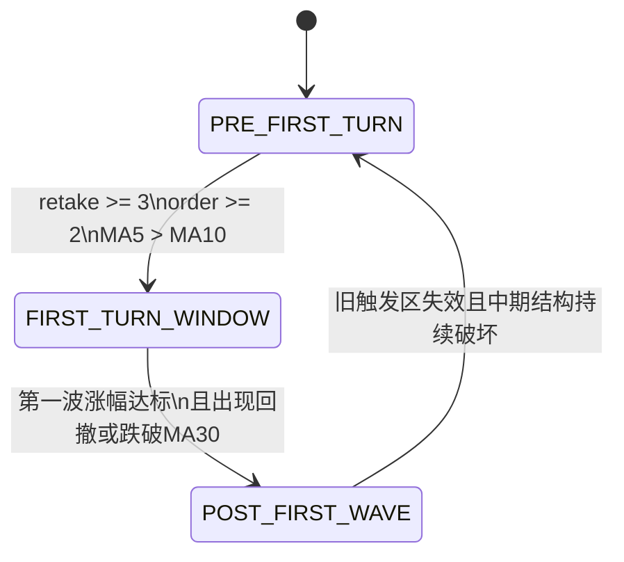

# A-PreV2「早期转强」技术选股当前实现说明（V3.0，历史版本）

> 本文为历史版本。当前实现、前复权口径、三种生命周期和评分规则以 [A-PreV2 技术选股算法实现说明（当前版）](./A-PreV2_技术选股算法实现说明.md) 为准；该文档保留用于追溯 V3 方案。

> 本文以当前代码实现为唯一依据，说明界面上唯一开放的技术选股策略 **A-PreV2 / 早期转强** 如何运行、如何计算、如何判定及如何落库。它是实现说明，不构成收益承诺或投资建议。
>
> 代码基线：`backend/screening/early_turn_service.py`、`backend/screening/early_turn_engine.py`、`backend/market_review/api.py`、`backend/screening/storage.py` 与 `prototype/zip (2)/app/components/SingleStockTestView.tsx`。

## 1. 范围与职责

### 1.1 界面可选策略

单股策略诊断页的 `STRATEGIES` 目前只注册一个策略：

```ts
const STRATEGIES = [
  { id: 'A_PRE_V2', name: '🧪 A-Pre V2 早期转强实验', ... },
];
```

主界面的“技术选股”页面仅挂载 `EarlyTurnFunnel`。这意味着用户界面只暴露 A-PreV2；本说明不涉及删除、停用或改写仓库内其他策略代码。

### 1.2 策略要回答的问题

A-PreV2 寻找的是一只股票由弱势或整理状态向**首次早期转强**迁移的技术窗口。它将下列问题拆开处理：

1. 均线是否压缩、交叉并开始重排；
2. 价格是否重新站回中短期成本区；
3. 转强是否足够新鲜、成交是否有确认；
4. 是否已走完本轮第一波，或出现急跌后的反射性反弹；
5. 即使仍有技术信号，当天的位置是否偏离过大。

因此，`signal_status`（技术状态）与 `entry_extension_state`（接入位置）是两个独立结论；“被选中”也不等于“建议追高买入”。

## 2. 端到端执行链路


### 2.1 调用入口

| 用途 | API | 实际行为 |
| --- | --- | --- |
| 同步运行 | `POST /api/early-turn/run` | 先同步目标交易日数据，再执行技术扫描并返回摘要。 |
| 异步运行 | `POST /api/early-turn/run-async` | 同步数据、执行技术扫描，并为 `FIRST_TURN_WINDOW` 生命周期股票批量生成经营、题材和交易特征；其它生命周期可从列表或详情中手动触发。 |
| 结果列表 | `GET /api/early-turn/runs/{run_id}/stocks` | 按状态、得分、行业、概念、关键词分页读取某一运行批次。 |
| 单股逐日诊断 | `GET /api/strategy/single-stock/eval` | 对日期区间内每个交易日重新按当日可见数据计算，输出得分轨迹与 K 线。 |

全市场运行时，资产池来自 `screening_asset_master` 中 `asset_type = 'stock'` 的全部股票；未传 `ts_code` 时没有内置样本股票或前 N 只股票限制。传入 `ts_code` 时，服务会解析代码、名称、行业或同花顺概念，并仅评估匹配出的范围，适用于定向诊断。

## 3. 数据、时间一致性与特征构造

### 3.1 输入数据与 Point-in-Time 原则

每只股票的特征均从 `screening_daily_bar` 读取：

```sql
select trade_date, open, high, low, close, vol, amount
from screening_daily_bar
where asset_code = %s and trade_date <= %s
order by trade_date desc limit 150
```

读取后按日期正序重建 DataFrame。所有滚动均线、ATR、交叉计数及生命周期扫描都只使用 `trade_date` 当日及以前的 K 线，不引用未来交易日。因此同一历史日期的单股回放会重新在该日期截面计算，不复用未来快照。

构造的基础序列包括：MA5/10/20/30/60、TR 与 ATR20。其中：

\[
TR_t = \max(H_t-L_t, |H_t-C_{t-1}|, |L_t-C_{t-1}|)
\]

\[
ATR20_t = mean(TR_{t-19}, ..., TR_t)
\]

### 3.2 当前实现的有效历史范围

- 特征函数在 K 线少于 15 根时返回空字典；该股票不会写入本次结果。
- 生命周期扫描使用已读取的全部 150 根 K 线（前 15 根作为指标预热区）：`range(15, len(df))`。
- MA60、ATR20 等指标需要更长历史才会完全形成；当前代码对尚未形成的数值按字段默认值参与计算，见第 9 节的实现边界。

### 3.3 特征表

| 特征 | 当前计算方式 | 用途 |
| --- | --- | --- |
| `retake_count` | 收盘价高于 MA5/10/20/30 的根数 | 成本区夺回、首次窗口与新鲜度的硬门槛。 |
| `days_retake_3ma` | 连续 `retake_count >= 3` 的交易日数 | 新鲜度及夺回时效扣分。 |
| `cross_pair_count_10d` | 最近 10 日中发生过相对位置翻转的 MA 对去重数；6 个组合为 5-10、5-20、5-30、10-20、10-30、20-30 | 均线结扎。 |
| `cross_event_count_10d` | 上述 MA 对每次方向翻转的累计次数 | 震荡杂噪扣分。 |
| `order_score` | `MA5>10`、`MA5>20`、`MA10>20` 各 1 分，`MA20>30` 为 0.5 分 | 方向性排列与首次窗口门槛。 |
| `order_improvement` | 当前 `order_score - 5日前 order_score` | 排列改善加分。 |
| `volume_ratio` | 当日 `amount / 最近60日amount中位数` | 量能确认。 |
| `dist_high_60` | `(60日最高价 - 当前收盘价) / 当前收盘价` | 上方空间评分。 |
| `overhead_resistance_flag` | 60 日内、当前价上方 0%~6% 内局部峰值至少 2 个 | 上方阻力判断。 |

## 4. 生命周期：识别“第一次有效转强”

策略并非仅看当前截面。`calculate_features_from_bars()` 会逐日回放当前可见的 150 根历史 K 线，允许一次回放中经历多个 Episode，最终输出评估日所在的最新一轮。



| 生命周期状态 | 判定 | 业务含义 |
| --- | --- | --- |
| `PRE_FIRST_TURN` | 尚未出现首次触发条件 | 仍处于准备或弱势阶段。 |
| `FIRST_TURN_WINDOW` | 首次满足 `retake_count >= 3`、`order_score >= 2` 且 `MA5 > MA10` | 记录 `first_trigger_date` 与 `first_trigger_close`，进入 A-PreV2 希望捕捉的窗口；若随后收盘跌到触发价 12% 以下或跌破触发前阶段低点，则清空该触发并回到 `PRE_FIRST_TURN`。 |
| `POST_FIRST_WAVE` | 首次触发后至少经过 5 个交易日，`max_close` 相对触发价上涨至少 6% 或 `max_high` 达到 2.5 ATR；随后从 `max_close` 回撤至少 6% 或收盘跌破 MA30 | 视为本轮第一波已完成。只有同时满足：从本轮高点回撤至少 25%、收盘低于首次触发价 8% 以上，并且连续 5 日低于 MA30、连续 3 日低于 MA60 或形成新的 60 日低点，才结构重置回到 `PRE_FIRST_TURN`。 |

在未触发结构重置前，进入 `POST_FIRST_WAVE` 后评估引擎将技术状态锁为 `POST_FIRST_WAVE`，不因短期重新站上均线或单纯高位回撤而重新标为新的早期转强周期。结构重置完成后，回放才会继续寻找下一轮触发。

## 5. 七项评分模型（100 分制）

总分是以下七项的算术和，上限为 100 分：

\[
Score = Background + Transition + Retake + Direction + Freshness + Volume + Space
\]

### 5.1 背景底分（0/5/10/12/15）

`turn_type` 从近 60 日的既往站上均线情况推导：

| 背景 | 分数 |
| --- | ---: |
| `FIRST_TURN` | 15 |
| `SECONDARY_TURN` | 12 |
| `CONSOLIDATION_RESTART` | 10 |
| 其他/未识别 | 5 |

这是评分背景，不会覆盖第 4 节的 `turn_episode_state` 生命周期结论。

### 5.2 均线状态转换（最高 25）

先将 MA5/10/20/30 中有效均线排序。当前实现取“任意连续三个排序后均线”的最小跨度：

\[
spread = min(sortedMA_3-sortedMA_1,\; sortedMA_4-sortedMA_2)
\]

\[
spreadATR = spread / ATR20
\]

| 条件 | 分数 |
| --- | ---: |
| `spreadATR <= 0.51 / 0.80 / 1.20` | +15 / +10 / +5 |
| `spread / spread_5d < 0.80 / 0.95` | +5 / +3 |
| 10 日 MA 交叉对 `>= 3 / >= 2` | +5 / +3 |
| 10 日交叉事件 `>= 8 / >= 4` | −6 / −3 |

本项最终裁剪到 `[0, 25]`。注意：当前特征构造未写入 `ma_spread_5d_ago`，所以引擎会以 `spread * 1.2` 作为该字段的默认值，压缩比固定约为 `0.833`，在通常 `spread > 0` 时对应 +3 分而非 +5 分。这是当前代码行为。

### 5.3 价格夺回成本区（最高 15）

| `retake_count` | 分数 |
| --- | ---: |
| 4 | 15 |
| 3 | 10 |
| 2 | 5 |
| 其他 | 0 |

若连续站上至少三根均线超过 3 天，额外扣 5 分，最低不低于 0。

### 5.4 方向性转向（最高 15）

| 条件 | 分数 |
| --- | ---: |
| `order_score >= 3 / >= 2` | +10 / +5 |
| `order_improvement > 0` | +5 |

### 5.5 突破新鲜度（最高 10）

新鲜度有硬前提：仅当 `retake_count >= 3` 且 `days_retake_3ma >= 1` 时才计分；否则为 0。

| 连续站上 3MA 天数 | 分数 |
| --- | ---: |
| 1–2 | 10 |
| 3–5 | 7 |
| 6–10 | 4 |
| >10 | 1 |

### 5.6 量能确认（最高 10）

| `volume_ratio` | 分数 |
| --- | ---: |
| `>= 1.5` | 10 |
| `>= 1.1` | 6 |
| `>= 0.8` | 4 |
| `< 0.8` | 2 |

### 5.7 空间与延伸（最高 10）

\[
extensionATR = (close-MA20) / ATR20
\]

| 条件 | 分数 |
| --- | ---: |
| `extensionATR <= 1.0 / 1.5 / 2.0` | +5 / +3 / +1 |
| `dist_high_60 >= 8% / >= 4%` | +5 / +3 |
| 若前两档空间均未满足且无上方阻力 | +2 |

## 6. 最终状态与选中规则

### 6.1 技术信号 `signal_status`

| 优先级 | 条件 | 输出 |
| ---: | --- | --- |
| 1 | 生命周期为 `POST_FIRST_WAVE` | `POST_FIRST_WAVE` |
| 2 | `structural_damage_flag=true` | 仅保留结构受损提示；不改变新的生命周期状态，也不取消正式候选判定。 |
| 3 | `FIRST_TURN_WINDOW` | 总分 `>=75` 且处于该生命周期时，`selected=true`。 |
| 4 | 其他生命周期 | 不满足正式候选条件时 `selected=false`；总分仍完整保留，供筛选和诊断使用。 |

`state` 保存为与 `signal_status` 相同的兼容字段。正式候选条件是：

```python
selected = turn_episode_state == "FIRST_TURN_WINDOW" and total_score >= 75

# 当前未站上任何核心均线时，正式排序分封顶；原始分保留审计
if retake_count == 0:
    total_score = min(raw_total_score, 49)
```

### 6.2 结构受损过滤

`structural_damage_flag` 要同时满足以下三项：

1. 最近 20 日的 `最高价→最低价` 跌幅至少 20%；
2. 60 日最低点距今不超过 15 个交易日；
3. 当前 MA60 小于 10 个交易日前 MA60。

它只在结果原因中写入结构受损警告，不再把生命周期映射成旧的多级信号状态。

### 6.3 买点偏离 `entry_extension_state`

| 状态 | 条件 |
| --- | --- |
| `NOT_APPLICABLE` | `POST_FIRST_WAVE`。 |
| `is_overextended=true` | `extensionATR >2.0`、相对 MA20 偏离 >18%，或当前交易日涨幅 >=15% 任一满足；不取消 `selected`。 |
| `EXTENDED` | 未满足上述严重条件，但相对首次触发涨幅 >4%，或 `extensionATR >1.5`。 |
| `NORMAL` | 其余情况。 |

`is_overextended` 在 ATR 偏离超过 2、相对 MA20 偏离超过 18%，或当前交易日涨幅达到 15% 任一条件满足时为真。该布尔值不取消 `selected`，只向界面提示位置风险；旧 `entry_extension_state` 继续保留供兼容和审计。

## 7. 关键实现代码

### 7.1 逐日生命周期扫描

```python
if first_trigger_idx is None:
    if retake_k >= 3 and order_score_k >= 2.0 and m5_k > m10_k:
        first_trigger_idx = k
        first_trigger_date = str(row_k['trade_date'])
        first_trigger_close = close_k
        first_trigger_atr20 = atr_k
        turn_episode_state = "FIRST_TURN_WINDOW"
else:
    gain_pct = (max_close_since_trigger - first_trigger_close) / first_trigger_close
    gain_atr = (max_high_since_trigger - first_trigger_close) / first_trigger_atr20
    drawdown_pct = (max_high_since_trigger - close_k) / max_high_since_trigger
    if days_since_trigger >= 5 and (gain_pct >= 0.06 or gain_atr >= 2.5) and (
        drawdown_pct >= 0.06 or close_k < m30_k
    ):
        turn_episode_state = "POST_FIRST_WAVE"
```

### 7.2 评分合成与状态分流

```python
total_score = round(min(100.0, (
    bg_score + score_transition + score_retake + score_direction
    + score_freshness + score_vol + score_space
)), 1)

signal_status = legacy_signal_status(total_score)  # 兼容字段，不作为主生命周期
if turn_episode_state == "POST_FIRST_WAVE":
    signal_status = "POST_FIRST_WAVE"
selected = turn_episode_state == "FIRST_TURN_WINDOW" and total_score >= 75
```

### 7.3 结果持久化

每次运行先创建一个独立的 `early_turn_run`，完成后把摘要写回该批次；每一只成功计算的股票在 `early_turn_result` 中以 `(run_id, ts_code)` 唯一保存。核心可复核字段包括：

- 结果：`total_score`、`state`、`selected`、`is_overextended`；
- 生命周期：`turn_episode_state`、首次触发日期/价格、触发后收益；
- 数据依据：完整 `features_json`、`score_detail_json`、`reasons_json`；
- 风险标记：`structural_damage_flag`、`entry_extension_state`。

这使同一运行批次可以按当日快照复盘，而不会被下一次运行覆盖。

## 8. 校验与测试现状

现有自动化测试覆盖了引擎关键规则：

- `backend/screening/test_early_turn.py`：基础评分、内置正样本定义；
- `backend/tests/test_early_turn_3tier.py`：新鲜度前置条件、第一波完成退出、结构受损封顶、信号与偏离状态解耦。

运行后可从 `summary_json` 复核 `total_evaluated`、按状态的 `counts`、`selected_count`，并使用结果 API 校验入库项的得分、特征和状态。单股诊断 API 可在任意区间逐日重算，作为个股级别的可解释性核验。

## 9. 当前实现边界与维护注意事项

以下内容是当前代码的实际行为，应在调整策略或解释历史结果时明确考虑：

1. **生命周期回看窗口为当前读取的 150 根日 K，而非跨全历史永久保存。** 回放可以在这 150 根 K 线内经历“触发失败重置”和“POST 结构重置”并产生多轮 Episode；若更早的历史不在窗口内，当前计算不会看到它。
2. **少于 15 根 K 线的股票会被跳过且不入库。** 当前运行摘要只记录成功评估数，未单列跳过股票数与原因；数据质量复核时需要额外比对资产池总数与 `total_evaluated`。
3. **指标预热不足会使用当前代码的默认数值。** 例如缺失 `atr20` 时引擎以 `close * 3%` 替代；缺失均线以 0 参与部分计算。这是实现事实，不应把这类结果等同于拥有完整 MA60/ATR20 历史的结果。
4. **压缩改善度字段尚未由特征层显式提供。** 如第 5.2 节所述，当前评分会走引擎默认值。若未来要把它改为严格的“5 日前实际 spread”，属于策略规则变更，应先确认评分方案并补充回归验证。
5. **异步全市场入口会在技术筛选后调用候选详情整理。** 该后续步骤服务于候选研究展示，不参与 A-PreV2 的七项技术得分或状态判定；同步入口仅执行到技术扫描结果。
6. **单股诊断输出只保留最近 90 根 K 线供图表展示。** 这不改变该区间每个交易日的评分计算，但前端图表不能当作全历史数据导出。

## 10. 维护时的不可变约束

对 A-PreV2 的任何改动应保持如下原则：

- 数据同步、特征计算、评分、状态判定、落库任一核心步骤失败时应显式失败，不以样本、截断结果或静默跳过伪造完成；
- 评分阈值、生命周期规则、资产范围、历史窗口或默认值的调整，均属于策略变更，需先确认后再实施；
- 修改后应至少复核全市场评估数量、状态分布、关键正/反样本、特征与入库值一致性，并记录配置版本；
- 不要因当前界面只展示 A-PreV2 而删除其他策略的源代码或数据结构。
