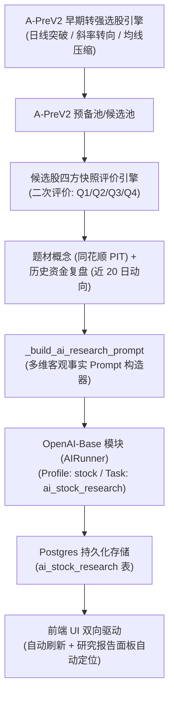
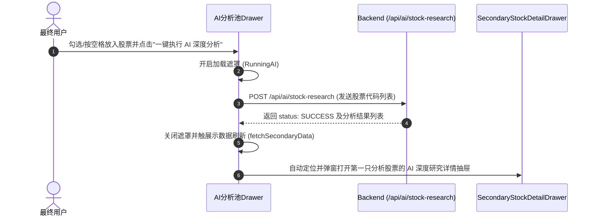

# A-PreV2 候选股 AI 深度研究系统与 OpenAI-Base 集成设计与实现文档

本文档全面梳理 LLL 系统中 **A-PreV2 选股系统**、**候选股四方二次评价引擎**、**历史资金复盘主线提取** 与 **OpenAI-Base 基础模块** 对接的架构设计、数据链路、提示词算法与前端 UX 交互规范。

---

## 一、 系统设计定位与总体架构

A-PreV2 选股系统的核心目标是**“寻找早期转强标的并进行研究优先级判断”**，而非简单的“预测明日涨跌”。

AI 深度研究系统处于整个选股漏斗的终局链路：


---

## 二、 四维快照与核心数据输入

在调用 AI 之前，后端 `ai_deep_research_service.py` 会拉取以下多维客观事实数据，拒绝由大模型凭空凭记忆编造数据：

### 1. Q1 技术形态快照 (`sec_snap`)
- **A-PreV2 得分与状态**：技术形态综合打分、`EARLY_TURN`（早期转强）或 `PRE_READY` 候选状态。
- **转向类型**：如斜率转向、均线压缩放量突破等。

### 2. Q2 经营变化事实 (`evidence`)
- **点对点 (PIT) 财报事实**：严格只读取查看日期 `as_of_date` 之前已公告的营收、归母净利润、扣非净利润及经营现金流。
- **边际变化**：如 `TURNAROUND`（扭亏为盈）、`LOSS_NARROWING`（亏损收窄）。
- **前瞻业绩**：最新业绩预告（区间）与业绩快报。
- **风险标记**：如 `TURN_TO_LOSS`（由盈转亏）、`LOSS_WIDENING`（亏损扩大）、营收大幅下滑等。

### 3. Q3 主题内表现与主力关联 (`leadership`)
- **主线匹配机制**：AI 结合近 20 日的【历史资金复盘】，首先识别当时盘面真正获得资金认可的**活跃主线题材**。
- **概念相对地位判定**：评估股票在其核心同花顺概念/主营业务中的盘面相对地位，分为：
  - `先锋 (Pioneer)`：领头启动、弹性极强
  - `高弹性跟随 (Elastic Follower)`
  - `容量核心 (Capacity Core)`：大市值中枢
  - `普通跟随 (Ordinary Follower)`

### 4. Q4 交易容量与活跃度 (`supply`)
- **自由流通市值与容量**：判断股票容量类型（微盘/小盘弹性/中盘/大盘）。
- **成交与换手**：当前成交额、20日成交额中位数、换手率与自由流通换手率。

### 5. 题材概念底库 (`concepts_info`)
- **同花顺概念匹配**：过滤得到个股归属的概念与题材标签。
- **时序安全性标记**：`PIT_SAFE` 标记，防止引入未来概念标签。

### 6. 近 20 日历史资金复盘记录 (`market_reviews`)
- 读取查看日期之前 `review_date <= as_of_date` 的历史每日资金复盘数据，帮助 AI 还原当时市场资金偏好的真实主线上下文。

---

## 三、 Prompt 构造算法与提示词设计

Prompt 构造器函数 `_build_ai_research_prompt` 将上述客观事实组装为结构化文本。

### Prompt 设计结构：
```markdown
你在做“研究优先级判断”，不是预测明日涨跌。

股票代码: {ts_code}
查看日期: {as_of_date}

【1. 技术形态】
- 得分: {sec_snap.aprev2_score} | 状态: {sec_snap.aprev2_status} | 转向类型: {sec_snap.turn_type}

【2. 最近经营变化】
- 最近季度表: {quarter_facts_json}
- 经营标签: {fact_tags_json}
- 最新预告 / 最新快报: {forecast_info} / {express_info}
- 风险标记: {risk_flags_json}

【3. 主题内表现】
- 当前状态: {leadership.leadership_state}
- 说明: AI 需要先判断这只股票真正对应的活跃题材，再基于全市场同主题股票生成相对地位判断。

【4. 交易容量与活跃度】
- 类型: {supply.supply_profile_label} | 自由流通市值: {supply.free_float_mv} 亿元
- 当前成交额 / 20日中位数: {amount} / {amount_median_20}

【5. 题材与业务标签】
- 包含标签: {concepts_text}

【6. 历史资金复盘 (近 20 个交易日)】
{market_reviews_json}

请严格按 Markdown 格式输出研究结论，包含:
## 研究结论 (研究优先级: 高 / 中 / 低 / 证据不足)
一句话结论...
## 1. 当前市场上下文
## 2. 公司与当前主题的真实关联 (明确分类: 核心业务/重要业务/布局但贡献不明/交易属性/弱相关)
## 3. 公司层面证据
## 4. 主题内表现
## 5. 交易容量与可能市场角色 (先锋/高弹性跟随/容量核心/普通跟随)
## 6. 主要正面证据
## 7. 主要反证与风险
## 8. 不确定性
## 9. 最终研究建议
```

---

## 四、 OpenAI-Base 模块集成架构

选股 AI 深度研究完全通过 LLL 内置的 `OpenAI-Base` 模块实现：

```python
from backend.openai_base.config import Settings
from backend.openai_base.db.repository import RuntimeRepository
from backend.openai_base.lll_market_data import LLLMarketDataProvider
from backend.openai_base.runtime.runner import AIRunner
from backend.openai_base.schemas.run import AIRunRequest

settings = Settings.from_env()
repository = RuntimeRepository(db_url)
market_data_provider = LLLMarketDataProvider(db_url)

runner = AIRunner(settings, repository, market_data_provider=market_data_provider)

request = AIRunRequest(
    profile="stock",
    task="ai_stock_research",
    input=run_input,
)
response = runner.run(request)
```

### 多只股票处理原则：
当在分析池中选择多只股票时，后端接口 `/api/ai/stock-research` 采取**循环独立处理**机制（非合并批量处理）：
- **独立性**：每只股票独立提取快照、构造 Prompt、独立发起 `AIRunner.run`。
- **优势**：保证上下文纯净，防止股票间数据干扰，每只股票单独写入 Postgres 并获得独立的 `analysis_id`。

---

## 五、 数据库存储表设计 (`ai_stock_research`)

AI 分析完成后，结果存入数据库 `ai_stock_research` 表：

| 字段 | 类型 | 说明 |
| :--- | :--- | :--- |
| `analysis_id` | VARCHAR | 主键，格式 `AIR_{ts_code}_{as_of_date}_{hash}` |
| `ts_code` | VARCHAR | 股票代码（如 `600518.SH`） |
| `as_of_date` | VARCHAR | 评估交易日（如 `20260810`） |
| `priority` | VARCHAR | 从 Markdown 解析的研究优先级（`高`/`中`/`低`/`证据不足`） |
| `result_markdown` | TEXT | 完整的 AI 研究报告 Markdown |
| `model` | VARCHAR | 实际调用的模型名称（从 `settings.default_model` 获取，如 `gpt-5.6`） |
| `uncertainty_json` | JSONB | 解析出的不确定性列表 |
| `web_search_used` | BOOLEAN | 是否启用了 Web 检索 |
| `status` | VARCHAR | `READY` 状态 |

---

## 六、 前端 UI/UX 交互流程规范

配合后端的完整调用，前端界面交互规范如下：



1. **执行反馈**：显示加载蒙层，展示推进进度；
2. **刷新与自动定位**：分析完成后，静默刷新候选股列表，并**自动弹窗呈现**最新生成的 AI 深度研究报告；
3. **异常处理**：若后端返回错误，进行气泡提示，不静默挂起或无感知关闭。
